# FCPU Firmware Design Document

> arc42 template 기반 FCPU firmware 설계 문서. 이 파일이 원본(source of truth)이며, HTML/PDF는 `build.mjs`로 이 파일에서 생성한다.

| 항목 | 내용 |
|---|---|
| 대상 | Keystone FCPU firmware (HBF TGTM 제어) |
| 버전 | 0.1 |
| 상태 | Draft |
| 작성자 | Heejoon Lee |
| 작성일 | 2026-11-02 |

**Change log**

| 버전 | 날짜 | 작성자 | 변경 내용 |
|---|---|---|---|
| 0.1 | 2026-11-02 | Heejoon Lee | 최초 작성. 기존 `docs/fcpu/*` 설계 노트를 arc42 형식으로 재구성하고 대체함 |

**이 문서를 읽는 법**

- 이 문서는 구현 요약이 아니라 **설계와 의도**를 기술한다. 이 문서만으로 동작하는 FCPU firmware를 다시 만들 수 있어야 한다. 기존 code는 참고 자료일 뿐 기준(ground truth)이 아니다.
- 기술 용어(Descriptor, Mailbox, Queued request, Execute 등)는 영어로 쓴다. 정의는 [12. Glossary](#12-glossary)에 있다.
- 파일 구성, 함수 signature, C struct는 이 문서의 범위가 아니다. Module 간 경계는 **책임, 소유 상태, 계약(contract)** 으로 기술한다.
- 아직 확정되지 않은 사실은 *TBD-nn* 으로 표시한다. 전체 목록은 [11.3 Open Items (TBD)](#113-open-items-tbd)에 있다. TBD는 설계의 빈칸이 아니라 **사실(값, bit 배치)의 빈칸**이며, 설계는 이를 한 곳(정의 table)에서만 참조하도록 되어 있다.
- "해야 한다(must)"는 위반하면 설계가 깨지는 규칙, "한다"는 현재 정책(바꿀 수 있음)을 뜻한다.

---

## 1. Introduction and Goals

### 1.1 Requirements Overview

Keystone은 HBF base die의 traffic generator인 **TGTM**(Traffic Generator / Traffic Monitor)을 시험하기 위한 test firmware이다. System은 세 부분으로 구성된다.

- **ICPU**: 사용자(CLI)를 마주하는 CPU. 명령을 parsing하여 FCPU에 request를 보내고 결과를 사용자에게 보여준다.
- **FCPU**: TGTM을 제어하는 CPU. **이 문서의 대상이다.**
- **TGTM**: Descriptor에 기술된 AXI traffic을 발생시키고 그 response를 기록하는 hardware block.

ICPU는 TGTM에 직접 접근하지 않는다. 모든 TGTM 접근은 FCPU를 거친다.

FCPU firmware가 제공해야 하는 기능은 다음과 같다.

| ID | 기능 | 설명 |
|---|---|---|
| F1 | Ready gate | ICPU가 설정하는 Ready word가 set일 때만 shared memory에 접근한다. |
| F2 | Mailbox memory access | DM, UM, RM의 한 word를 즉시 read/write한다. Task 실행 중이거나 해당 memory가 busy이면 거절한다. |
| F3 | Mailbox CSR access | TGTM CSR 하나를 즉시 read/write하고, 접근 전후의 Status와 Err type을 함께 돌려준다. Task 실행 중에도 동작한다. |
| F4 | Mailbox Execute | Mailbox로 Execution bit 0에 1을 쓰면, DM에 이미 있는 Descriptor로 single-task workload를 시작하고 끝까지 감시한다. |
| F5 | Mailbox Stop | Mailbox로 STOP register를 쓰면 TGTM을 강제 정지시키고 active workload를 cancel한다. |
| F6 | Queued request 순서 처리 | Request queue의 request를 queue 순서대로 한 번에 하나씩 처리하며, workload가 active인 동안에는 받지 않는다. |
| F7 | Sequence 검사 | 모든 Queued request는 Sequence에 속하며, 순서가 어긋나면 실행하지 않고 `sequence` error를 보낸다. |
| F8 | DIRECT_DM | CSR config, Descriptor, UM data를 TGTM에 load한다(실행하지 않음). |
| F9 | CONTROL | 정해진 CSR 조작 하나를 queue 순서에 맞춰 실행한다. EXECUTE operation은 single-task workload를 시작한다. |
| F10 | API_SET (Generated workload) | Generator 이름과 parameter로 FCPU가 Descriptor를 만들어 하나 이상의 task로 실행한다. **아직 production 기능이 아니다.** |
| F11 | Task 감시 | 모든 task를 끝날 때까지 감시하고, timeout이면 Stop을 쓰고, Stop 후에도 멈추지 않으면 TGTM stuck으로 판정한다. |
| F12 | Response selection / RM copy | Request가 RM by descriptor를 요구하면, task가 끝난 뒤 해당 Descriptor들의 command가 남긴 RM entry를 Response region에 복사한다. |
| F13 | 결과 보고 | Mailbox request는 같은 Mailbox word로, Queued request와 workload 결과는 Response queue로 보고한다. 모든 결과에는 Request status가 붙는다. |
| F14 | 진단 정보 | Error/timeout 시 Err type과 Current descriptor index를 보고하고, 내부 상태를 debug status block에 기록한다. |

### 1.2 Quality Goals

우선순위 순서이다. 상충할 때는 위의 목표가 이긴다.

| 순위 | Quality goal | 의미 |
|---|---|---|
| 1 | **Correctness / no lost reports** | FCPU는 보내야 하는 결과를 절대 버리지 않는다. Error, timeout, abort는 항상 보고되고, 모든 task outcome은 보고된다. 하나의 결과는 정확히 한 번 전달된다. |
| 2 | **HW safety** | TGTM이나 해당 memory가 busy인 동안 DM/UM/RM에 접근하지 않는다. 모든 task에는 timeout이 있으며, 멈추지 않는 TGTM(stuck)은 감지되고 이후 사용이 차단된다. |
| 3 | **Debug responsiveness** | Mailbox request는 task가 길게 실행되는 중에도 atomic step 하나 이내에 응답된다. |
| 4 | **Diagnosability** | 실패한 task의 Err type, 멈춘 위치(Current descriptor index), CSR 접근 전후의 Status를 보고하며, FCPU 내부 상태는 고정된 debug status block에 남는다. |
| 5 | **Extensibility** | 새 generator나 새 CONTROL operation은 국소적인 변경(정의 하나 + table 한 줄)으로 추가된다. |

### 1.3 Stakeholders

| 역할 | 관심사 / 이 문서에 기대하는 것 |
|---|---|
| FCPU firmware 개발자 | 이 문서만으로 FCPU를 구현·수정할 수 있는 module 경계, 상태 기계, 규칙, 정책 |
| ICPU firmware 개발자 | Shared memory protocol: 무엇을 쓰고, 무엇을 기다리며, 어떤 경우 거절되는지 |
| 검증(test) 엔지니어 | TGTM을 어떻게 구동하고 결과(RM, Err type, timeout)를 어떻게 얻는지 |
| TGTM HW 설계자 | Firmware가 의존하는 TGTM 동작(busy bit, Interrupt, STOP)과 TBD로 남은 사실 |
| AI coding agent | 설계 의도와 불변 조건(invariant)을 명시적으로 기술한 단일 문서 |

---

## 2. Architecture Constraints

### 2.1 Technical Constraints

| ID | 제약 | 배경 / 결과 |
|---|---|---|
| C1 | FCPU는 **ARM Cortex-M7** 위에서 OS 없이 동작하는 bare code이다. | 실행 흐름은 하나뿐이다(single thread of control). 공유 상태를 건드리는 ISR이 없으므로 locking이 필요 없고, 이것이 cooperative loop와 atomic step 개념의 전제이다. |
| C2 | TGTM과 ICPU는 모두 **polling**으로만 관찰한다. TGTM interrupt도, ICPU→FCPU doorbell IRQ도 쓰지 않는다. | TGTM의 "Interrupt"는 FCPU가 읽는 register bit일 뿐이다. FCPU는 절대로 hardware를 기다리며 block되어서는 안 된다. |
| C3 | ICPU ↔ FCPU **shared memory layout은 고정**되어 있다(기존 ICPU code와의 interface). | FCPU는 layout을 바꿀 수 없고 그대로 따라야 한다. [3.2](#32-technical-context), [12.3](#123-icpu--fcpu-interface-reference) 참고. |
| C4 | TGTM의 CSR과 memory(DM/UM/RM) interface는 hardware로 고정되어 있다. | [12.2](#122-tgtm-reference) 참고. 일부 의미와 bit 배치는 아직 TBD이다. |
| C5 | Request payload(최대 0x8000B 데이터)와 RM(32KB)은 FCPU 내부 memory에 복사(staging)하기에 너무 크다. | Bulk data는 shared memory와 TGTM 사이에서 직접 복사한다([D-02](#9-architecture-decisions)). |
| C6 | Cortex-M7은 weakly-ordered memory model을 가진다. | ICPU에 소유권을 넘기는 지점마다 memory barrier가 필요하다([8.4](#84-memory-ordering)). 각 region의 cache/MPU 속성은 TBD-17. |
| C7 | 구현 언어는 C이다. Dynamic allocation을 쓰지 않는다. | 모든 상태는 정적으로 할당된 하나의 상태 tree에 있다. |
| C8 | Timer를 쓰지 않는다. Timeout은 **loop 횟수(poll 횟수)** 로 센다. | TGTM에는 timer IP가 공급하는 Timer register가 있으나 FCPU timeout에는 쓰지 않는다([D-04](#9-architecture-decisions)). |

### 2.2 Organizational Constraints

| ID | 제약 | 배경 |
|---|---|---|
| O1 | 기존 ICPU code와 호환되어야 한다. | ICPU는 이미 존재하며, Mailbox/queue protocol과 Request status 값은 기존 code에서 온다. |
| O2 | TGTM에 대한 공식 spec 문서가 아직 없다. `ref/HBF_v0.7.pdf`(OCP HBF base die spec)에는 TGTM이 기술되어 있지 않다. | TGTM의 사실 정보는 [12.2](#122-tgtm-reference)에 모으고, 모르는 것은 TBD로 남긴다. |
| O3 | 이 문서는 계속 수정된다(수작업 편집, 출처 추가). | 원본은 markdown이며, HTML/PDF는 생성물이다. |

### 2.3 Conventions

- 용어는 [12. Glossary](#12-glossary)와 repository의 `GLOSSARY.md`를 따른다. *Avoid*로 표시된 옛 용어(job, window, direct queue 등)는 쓰지 않는다.
- Register는 offset과 이름으로 함께 표기한다. 예: Status (0x2C).
- 수치 값(Request status, data type, flag bit 등)은 [12.3](#123-icpu--fcpu-interface-reference)의 table에만 정의하고, 본문은 이름으로만 참조한다.
- Code에서 tunable 값(POLL_LIMIT 등)은 한 곳에서만 정의한다.

---

## 3. Context and Scope

### 3.1 Business Context

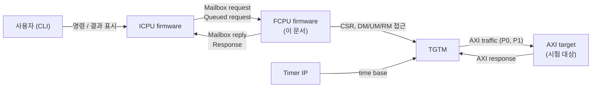

| 상대 | FCPU로 들어오는 것 | FCPU가 내보내는 것 |
|---|---|---|
| ICPU | Mailbox request(TGTM memory/CSR 접근), Queued request(DIRECT_DM, CONTROL, API_SET), Ready, ICPU가 response를 읽었다는 표시(Response queue read_count) | Mailbox reply, Response(command, progress, final, error), RM entry, Request queue 소비 표시(read_count) |
| TGTM | Status, Interrupt, Err type, Current descriptor index 등 CSR 값, RM의 Response, DM 내용 | CSR 쓰기(start/end index, Execute, STOP, 설정), DM에 Descriptor, UM에 write data |
| AXI target, Timer IP | (FCPU와 직접 상호작용 없음) | (없음) |

### 3.2 Technical Context

FCPU의 외부 channel은 두 가지이다.

| Channel | 매체 | 내용 |
|---|---|---|
| ICPU ↔ FCPU | Shared memory (고정 layout) | Ready, Mailbox(3 words), Request queue + Request payload, Response queue + Response region, UART channel(범위 밖) |
| FCPU ↔ TGTM | Memory-mapped TGTM window | CSR(32-bit registers), DM, UM, RM |

**Shared memory 요약** (정확한 표는 [12.3](#123-icpu--fcpu-interface-reference)):

| 영역 | 방향 | 역할 |
|---|---|---|
| Ready | ICPU가 설정 | FCPU는 shared memory 접근 전마다 확인한다. 정상 상황에서는 항상 set이다. |
| Mailbox | 양방향 | Mailbox request 하나. FCPU가 같은 word에 reply를 쓰고 done bit로 ICPU에 돌려준다. |
| Request queue | ICPU → FCPU | 32 entry `{start_addr, length}`, Request payload를 가리킨다. |
| Request payload | ICPU → FCPU | Queued request data: 8B header + data type별 data. |
| Response queue | FCPU → ICPU | 32 entry `{start_addr, length}`, Response region을 가리킨다. |
| Response region | FCPU → ICPU | 16B response + 최대 2048개의 RM entry. |

**Scope**

| 범위 안 | 범위 밖 |
|---|---|
| FCPU firmware 전체: shared memory protocol의 FCPU 측, TGTM 구동과 감시, Descriptor 생성(API_SET), 결과 보고, 진단 | ICPU firmware(CLI parsing, 표시), UART channel, TGTM 내부 구현, AXI target, boot loader와 platform init의 세부 |

---

## 4. Solution Strategy

| Quality goal / 제약 | 해결 방식 |
|---|---|
| C1, C2, Debug responsiveness | **하나의 cooperative main loop.** 매 iteration(scheduler step)은 hardware를 기다리지 않고 반환한다. 작업은 **atomic step**으로 쪼개지며, Mailbox는 atomic step 사이마다 처리된다. Interrupt도 thread도 없으므로 locking이 없다. |
| 책임 분리 | **소유 tree: scheduler → executor → monitor.** Scheduler는 *언제* 실행할지(transport, 순서, Sequence), executor는 *무엇을* 할지(request 의미, workload, task, response 내용), monitor는 task 하나를 *감시*한다. 호출은 tree 아래 방향으로만 간다([ADR 0002](#9-architecture-decisions)). |
| Correctness | **Workload는 한 번에 하나.** 모든 Execute는 task이고, 모든 task는 workload에 속하며, 끝날 때까지 감시된다. Execution register를 쓰는 곳은 단 하나(task 시작 절차)이다. |
| No lost reports | **Response slot 하나 + backpressure.** Response region은 하나이므로 ICPU가 이전 response를 읽을 때까지 다음 response를 만들지 않고 기다린다. 버리지 않는다. |
| HW safety | **Busy 규칙 + timeout + stuck.** Memory 접근 전 busy를 확인하고, 모든 task를 poll 횟수로 제한하며, Stop 후에도 멈추지 않으면 stuck으로 판정해 새 task를 차단한다. |
| C5 (크기) | **No staging.** Executor는 Request payload를 제자리에서 읽어 DM/UM으로 복사하고, monitor는 RM을 Response region에 직접 쓴다. |
| Mailbox와 queue의 차이 | **두 개의 진입점.** Mailbox request와 Queued request는 같은 CSR 접근으로 끝나더라도 executor에 서로 다른 진입점으로 들어온다. 공유하는 것은 저수준 TGTM access뿐이다. |
| Extensibility | **Generator 계약.** API_SET은 generator(검증 → 총 Descriptor 수, DM 채우기)로 추상화되어, 새 generator는 정의 하나와 table 한 줄이다. CONTROL operation도 table 기반이다. |
| Diagnosability | 모든 CSR Mailbox reply에 전후 Status/Err type을 붙이고, 실패한 task의 위치를 final response에 담으며, debug status block을 둔다. |

---

## 5. Building Block View

### 5.1 Whitebox Overall System (Level 1)

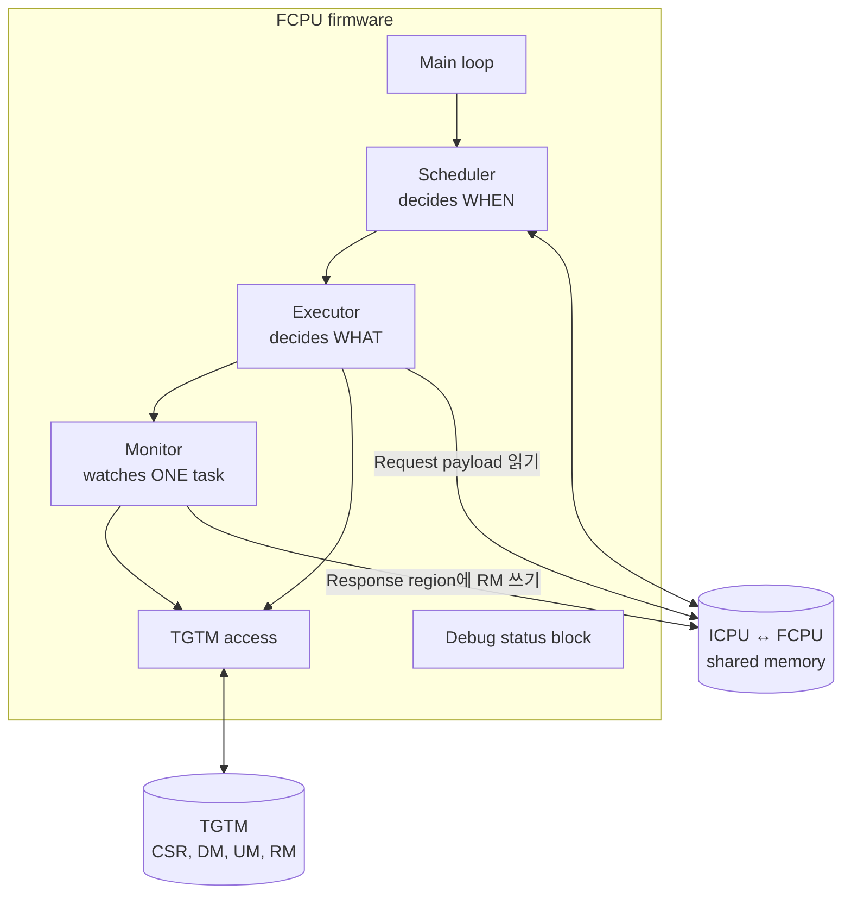

| Building block | 책임 | 소유 상태 |
|---|---|---|
| **Main loop** | 초기화 후 scheduler step을 무한히 반복한다. | 없음 |
| **Scheduler** | Ready 확인, Mailbox 처리, Queued request 수락(admission)과 Sequence 검사, response 전달. 언제 무엇이 실행될지 결정한다. | Transport(Ready, Mailbox, Request queue, Response queue), 열린 Sequence와 다음 기대 sequence number, pending response 하나, executor |
| **Executor** | Mailbox request와 Queued request의 의미를 실행하고, workload와 task를 진행하며, task 뒤에 무엇을 할지 결정하고 response를 만든다. | Active Queued request의 사본(header + payload 위치), workload, current task, held outcome, stuck flag, monitor |
| **Monitor** | Task 하나를 끝날 때까지 poll하고, timeout 시 STOP을 쓰고, outcome을 돌려준다. 요청 시 RM을 Response region에 복사한다. | Watch 상태, poll 횟수, 관찰한 Interrupt bit, Err type |
| **TGTM access** | DM, UM, RM, CSR을 읽고 쓰는 저수준 primitive. 규칙 판단은 하지 않는다. | 없음 |
| **Debug status block** | FCPU 내부 상태의 고정 layout 기록. Scheduler, executor, monitor가 각자 자기 field만 쓴다(그림에서는 생략). | 기록 자체 |

**구조 규칙** (위반하면 설계가 깨진다)

1. **호출은 tree 아래 방향으로만 간다.** Scheduler → executor → monitor → TGTM access. Monitor는 executor에 outcome을, executor는 scheduler에 step result를 *반환*한다. 위로 호출하지 않는다.
2. **Scheduler만 queue, Mailbox word, Ready를 만진다.** Executor는 넘겨받은 Request payload 영역만 읽고, monitor는 넘겨받은 Response region 영역에만 쓴다.
3. **Monitor는 task 뒤에 무엇을 할지 결정하지 않는다.** Request, workload, queue를 모른다.
4. **Mailbox와 queue는 다른 경로이다.** 서로 다른 진입점으로 executor에 들어간다.
5. **공유 전역 변수는 없다.** 모든 상태는 scheduler를 뿌리로 하는 하나의 tree에 있고 참조로 전달된다.

### 5.2 Level 2

#### 5.2.1 Scheduler

**목적**: ICPU ↔ FCPU transport를 소유하고, 각 request가 *언제* 실행될지 결정한다. Descriptor, busy, RM에 대해서는 모른다.

**소유 상태**

| 상태 | 의미 |
|---|---|
| Sequence open | FIRST가 수락된 후 아직 LAST가 오지 않음 |
| Expected sequence number | Sequence open일 때 다음 request가 가져야 할 번호 |
| Pending response | 전달을 기다리는 response 하나(있거나 없음) |
| Executor | 소유한 하위 module |

**제공하는 operation**

| Operation | 계약 |
|---|---|
| init | 모든 상태를 초기화한다: Sequence 닫힘, pending 없음, executor idle. |
| step | Main loop의 한 iteration. Hardware를 기다리지 않고 반환해야 한다. 순서는 아래와 같다. |

**한 step의 순서**

```text
step:
    shm ← Ready가 set인가                        # step마다 한 번 읽는다
    if shm and pending response 있음:
        전달 시도                                 # Response region이 free이면 16B를 쓰고 entry를 post
    if shm:
        Mailbox 처리                              # 최대 1개
    region ← (shm and pending 없음 and ICPU가 이전 response를 다 읽음) ? Response region : 없음
    if executor에 active workload 있음:
        executor.step(region) → step result 처리
    else if region 있음 and not executor stuck:
        Queued request 수락 시도(region)
```

이 순서의 의도:
- 전달을 먼저 시도하므로, 직전 step이 만든 response는 다음 step에서 바로 나간다.
- Mailbox는 매 step에서 처리되므로, Mailbox 응답 지연은 가장 긴 atomic step 하나로 제한된다.
- Region이 free일 때만 executor에 region을 넘기므로, executor의 한 step은 **최대 하나의** response만 만들 수 있고 그 response는 항상 저장될 곳이 있다(pending slot이 하나로 충분한 이유).
- Ready가 clear이면 shared memory 작업은 전혀 하지 않는다. 그래도 executor는 진행한다(monitor poll은 region이 필요 없다). Region이 필요한 step은 기다린다.

**Mailbox 처리**: done bit가 0이면 request가 있다. Mailbox word를 해석해 executor의 Mailbox 진입점에 넘기고, 돌려받은 reply를 같은 word에 쓴 다음 **마지막으로** done bit를 set한다([8.4](#84-memory-ordering)). Mailbox reply는 같은 step에 쓰이므로 pending slot이 필요 없다. ICPU는 done bit를 보기 전에는 다음 request를 쓸 수 없다.

**Queued request 수락(admission)**: executor가 idle이고, TGTM이 stuck이 아니며, Response region이 free일 때만 한다. 전체가 하나의 atomic step이다.

```text
admit(region):
    entry ← Request queue의 다음 entry          # write_count ≠ read_count일 때
    없으면 return
    header ← entry가 가리키는 payload의 처음 8B

    if header가 invalid:                          # 알 수 없는 data type, data type에 맞지 않는 flag,
        reject(entry, invalid)                    #   entry가 payload 영역 밖, length < 8 등
    else if not sequence_ok(header):
        reject(entry, sequence); Sequence 닫기
    else:
        Sequence open ← not LAST
        expected ← header.seq + 1
        executor.begin(header, entry 영역, region) → step result 처리

sequence_ok(h):
    if h has FIRST: return (Sequence 닫혀 있음) and h.seq == 0
    else:           return (Sequence 열려 있음) and h.seq == expected

reject(entry, status):
    entry 소비(read_count 증가)
    error response를 pending에 저장             # Need response와 무관하게 항상
```

- Sequence 검사는 admission의 일부이므로 executor는 순서가 어긋난 request를 볼 일이 없다.
- Sequence error 후에는 Sequence가 닫히므로 다음 request는 FIRST를 가져야 한다.
- `invalid`로 거절된 request는 Sequence 상태를 바꾸지 않는다.

**Step result 처리**: executor는 queue를 만지지 않고 원하는 일을 돌려준다.

| Step result 항목 | Scheduler의 동작 |
|---|---|
| consume | Request queue entry를 소비한다(read_count 증가). 이후 ICPU는 그 payload 영역을 재사용할 수 있다. |
| respond + response 내용 | Response를 pending slot에 저장한다. 다음 step에서 전달된다. |

**Response 전달**: Response region에는 16B response가 맨 앞에, 그 뒤에 RM entry가 온다. Region이 free(= pending 없음, Response queue의 read_count가 write_count를 따라잡음)일 때 16B를 쓰고, barrier 후 entry `(region 주소, 16 + 4 × RM 개수)`를 post한다. RM entry는 monitor가 이미 region에 써 두었다.

#### 5.2.2 Executor

**목적**: request가 *무엇을* 하는지 결정하고 실행한다. Workload와 task의 수명을 관리하고 response 내용을 만든다. Queue, Mailbox word, Ready는 만지지 않는다.

**소유 상태**

| 상태 | 의미 |
|---|---|
| Workload state | IDLE, WAIT_TASK, TASK_ENDED, NEXT_TASK. IDLE이 아니면 workload가 active이다. |
| Active request 사본 | Workload를 만든 Queued request의 header와 payload 위치(소비 전까지만 유효). |
| Workload | origin(QUEUED / MAILBOX), sequence number, Need response 여부, cancelled, 총 task 수, 끝난 task 수, generator(API_SET일 때) |
| Current task | workload 내 index, DM range(start..end), Response selection |
| Held outcome | 끝난 task의 outcome. TASK_ENDED에서 처리될 때까지 보관 |
| Stuck flag | TGTM stuck 상태 |
| Monitor | 소유한 하위 module |

**제공하는 operation**

| Operation | 호출 시점 | 계약 |
|---|---|---|
| mailbox(request) → reply | 모든 Mailbox request | 즉시, 한 번에 끝난다. Active request나 task를 바꾸지 않는다. 예외는 Mailbox Execute(workload 시작)와 Stop(cancel 표시)이다. |
| begin(header, payload 영역, region) → step result | 수락된 Queued request | Request의 atomic 부분 전체를 실행한다. Workload를 만들지 않는 request는 여기서 끝난다. |
| step(region 또는 없음) → step result | Workload가 active인 동안 매 scheduler step | Workload 상태 기계의 atomic step 하나를 실행한다. |
| active?, stuck? | Scheduler가 수락 여부를 판단할 때 | 상태 조회 |

##### Mailbox request 처리

| Request | 거절(`busy`) 조건 | 동작 |
|---|---|---|
| DM / UM / RM read | Task 실행 중(WAIT_TASK), Status에서 TGTM busy 또는 그 memory busy, 또는 stuck | (memory, index, word)를 읽는다. Reply: Request status, 읽은 값 |
| DM / UM / RM write | 위와 같음 | (memory, index, word)에 쓴다. Reply: Request status |
| CSR read | 없음 | Status, Err type 읽기 → register 읽기 → Status, Err type 다시 읽기. Reply: 네 번의 읽기 값, 읽은 값 |
| CSR write: Execution (0x08), bit 0 = 1 (**Mailbox Execute**) | Workload active, 또는 stuck | Mailbox Execute 시작(아래). Reply: 네 번의 읽기 값, 값 |
| CSR write: STOP (0x0C) | 없음 | 쓰기. Workload가 active이면 cancel 처리(아래 Stop 처리). Reply: 네 번의 읽기 값, 값 |
| CSR write: 0x00–0x28 중 STOP 외, Interrupt enable (0x74), Interrupt clear (0x7C) | Workload active | 쓰기 |
| 그 밖의 CSR write | 없음 | 쓰기 |

- 알 수 없는 memory type: `unsupported`. Index나 word가 범위 밖: `address`.
- "네 번의 읽기"는 접근 전후의 Status (0x2C, 하위 4 bit)와 Err type (0x64, 7 bit)이다. CSR reply의 Request status와 함께 packing된다(bit 배치 TBD-05).
- **Workload 중 CSR write를 막는 이유**: 0x00–0x28은 실행 중 task의 range와 실행 설정이다. Interrupt enable/clear를 바꾸면 monitor가 task의 끝을 보지 못한다([D-09](#9-architecture-decisions)).
- **Stuck 해제**: 모든 Mailbox CSR write 후, stuck이고 Status bit 0–3이 모두 low로 읽히면 stuck flag를 해제한다.

**Mailbox Execute**: 디버그 경로이다.

```text
workload ← { origin MAILBOX, 총 task 1, Need response: 항상 }
task     ← { index 0, DM range ← CSR의 Start index/End index를 다시 읽은 값, selection 없음 }
task 시작 절차 (CSR range는 그대로 둔다)
→ WAIT_TASK
```

DM은 있는 그대로 쓴다. DM이 비어 있거나 range가 잘못되었다면 TGTM이 error를 보고하고, 그것이 task outcome이 된다. RM은 복사하지 않는다. Task가 끝나면 mailbox-origin final response가 Response queue로 **항상** 간다. ICPU는 필요하면 Mailbox memory read로 RM을 읽는다.

**Stop 처리** (Mailbox STOP write, workload active일 때) — [D-08](#9-architecture-decisions)

| Workload 상태 | 동작 |
|---|---|
| WAIT_TASK (task 실행 중) | cancelled ← true. Monitor에 *외부 Stop*을 알린다(monitor는 STOP을 다시 쓰지 않고 STOPPING으로 간다). |
| TASK_ENDED (outcome 보관 중) | cancelled ← true. 이미 끝난 task의 outcome은 그대로 보고한다. 남은 task는 실행하지 않는다. |
| NEXT_TASK (Generated, task 사이) | cancelled ← true. 다음 step에서 다음 task를 시작하지 않고 final response(`aborted`)를 만든다. |

##### Queued request 처리 (begin)

Begin은 검사된 header, payload 영역, Response region을 받아 atomic하게 실행하고 step result를 돌려준다. **검사 후 적용(validate-then-apply)**: 모든 검사를 TGTM에 쓰기 전에 끝내서, 거절된 request는 TGTM을 건드리지 않는다([D-12](#9-architecture-decisions)).

| Data type | Workload | Atomic 부분 |
|---|---|---|
| DIRECT_DM | 없음 | ① Status bit 0–3 중 하나라도 set이면 `busy`. ② Length 검사: `8 + (Has config ? config 크기 : 0) + 16 × desc_count ≤ length`, 나머지는 Has UM이면 UM data(1B 이상, UM 크기 이하, TBD-10), 아니면 0이어야 한다. 어긋나면 `length`. ③ `desc_start + desc_count ≤ 2048`이 아니면 `address`. ④ Has config이면 config 값 검사(실패 시 `csr`). ⑤ 적용: config를 CSR에 쓰기, Descriptor `desc_count`개를 DM의 `desc_start`부터 복사, Has UM이면 나머지를 UM에 복사. ⑥ consume, command response. |
| CONTROL (EXECUTE 외) | 없음 | Header 뒤 8B: csr_offset(2B), operation(2B), control value(4B). Length ≠ 16이면 `length`. Operation table에서 찾아 실행(없으면 `unsupported`). Consume, command response(읽은 값이 있으면 data에 담음). |
| CONTROL EXECUTE | Single task | ① Status busy면 `busy`. ② CSR Start index/End index를 다시 읽어 DM range로 쓴다. `start ≤ end ≤ 2047`이 아니면 `address`([D-07](#9-architecture-decisions)). ③ Response selection ← RM by descriptor면 by-descriptor, 아니면 없음. ④ Consume. ⑤ Workload `{ QUEUED, seq, 총 task 1 }` 생성, task 시작 절차. ⑥ Command response("accepted"). → WAIT_TASK |
| API_SET | Generated, 1..n task | ① Generator lookup(없으면 `unsupported`). ② Generator 검증 → 총 Descriptor 수 N(오류 또는 N = 0이면 `invalid`). ③ Consume. ④ Task를 최대 2048개씩 나눈다: 총 task 수 = ⌈N / 2048⌉. ⑤ Command response. → NEXT_TASK |

- Command response는 Need response가 set일 때만 보낸다. Error response는 항상 보낸다.
- RM by descriptor가 set인데 Need response가 clear인 request는 `invalid`이다(결과 RM을 받을 방법이 없으므로, [D-13](#9-architecture-decisions)).
- Payload를 끝까지 읽은 뒤 consume하므로, consume 이후 executor는 payload를 다시 읽지 않는다. API_SET parameter는 begin에서 generator가 자기 상태로 해석해 두어야 한다.

##### Workload state machine

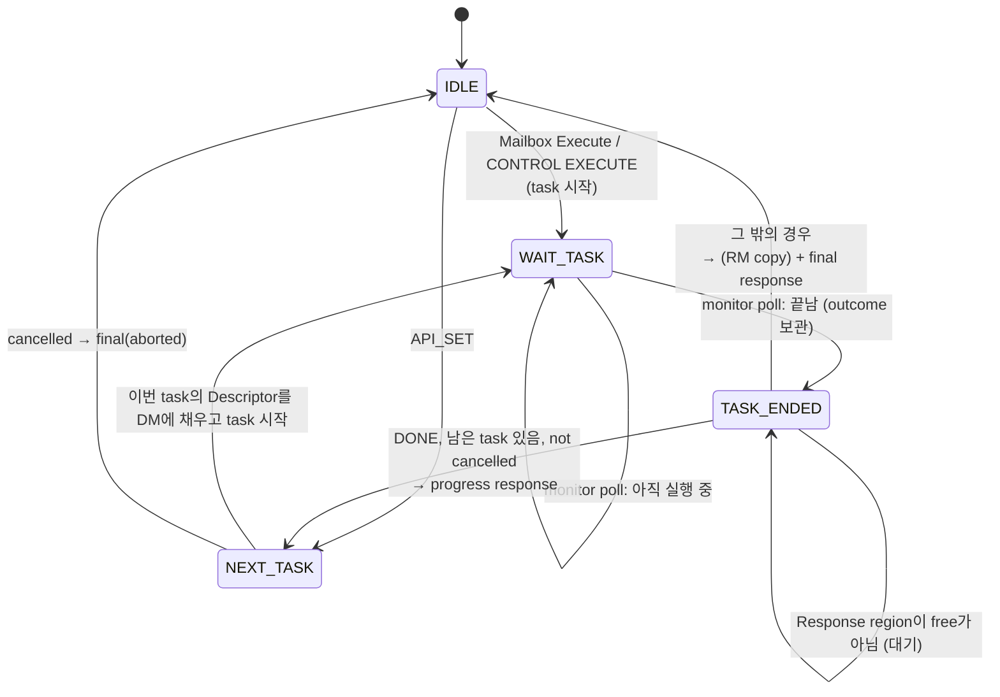

| 상태 | Region 필요 | 한 step의 동작 |
|---|---|---|
| WAIT_TASK | 아니오 | Monitor poll 한 번. 실행 중이면 반환. 끝났으면 outcome 보관, STUCK이면 stuck flag set. → TASK_ENDED |
| TASK_ENDED | 예(없으면 대기) | Outcome이 DONE이고 남은 task가 있고 cancelled가 아니면: progress response(Need response일 때) → NEXT_TASK. 아니면: origin QUEUED이고 outcome이 DONE 또는 ERROR이면 RM copy(selection, task DM range, region) → final response → IDLE |
| NEXT_TASK | 아니오 | cancelled이면 final response(`aborted`, 완료한 task 수 포함)를 만든다 — 이때는 region이 필요하므로 region이 없으면 대기. 아니면 generator로 이번 task 크기만큼 DM 0번부터 채우고, task 시작 절차(range 0..size−1) → WAIT_TASK |

**Generated workload는 DONE이 아닌 첫 task에서 멈춘다.** Final response는 그 task의 outcome과 RM을 담는다.

**Final response의 Request status**

| 끝난 상태 | Request status | 추가 정보 |
|---|---|---|
| DONE | OK | RM(selection이 있으면), cancelled이면 "cancelled after task k" 표시 |
| ERROR | execution | Err type, Current descriptor index, RM(selection이 있으면) |
| TIMEOUT | timeout | Current descriptor index |
| STUCK | timeout | stuck 표시 |
| STOPPED (외부 Stop) 또는 NEXT_TASK에서 cancel | aborted | 완료한 task 수 |

Final response가 Need response에 따라 억제되는 경우는 DONE(OK)뿐이다. ERROR, TIMEOUT, STUCK, aborted는 항상 보낸다. Mailbox Execute의 final은 항상 보낸다.

##### Task 시작 절차

Execution register를 쓰는 유일한 절차이다. 모든 task는 이 절차로 시작해야 한다.

```text
start_task(range, set_range):
    Interrupt clear (0x7C) ← 0x7           # Error, Completion, Timer 모두 clear
    if set_range:                           # FCPU가 range를 정하는 task(Generated)만
        Start index (0x00) ← range.start
        End index (0x04)   ← range.end
    Execution (0x08) ← 1 (bit 0)
    monitor.watch()                         # 바로 이어서 감시 시작
```

Interrupt를 Execute 직전에 clear하는 이유: 이전 task의 Completion/Error가 남아 있으면 monitor가 새 task를 이미 끝난 것으로 오판한다.

##### Generator (API_SET)

Generator 계약:

| Operation | 계약 |
|---|---|
| begin(params) | Parameter를 검증하고 내부 상태(다음 주소, 다음 ID 등)를 초기화한 뒤, 생성할 총 Descriptor 수를 돌려준다. 오류면 실패를 돌려준다. Begin 이후 payload는 소비되므로, 필요한 parameter는 모두 이때 가져가야 한다. |
| fill(dm_index, max) | 다음 Descriptor를 최대 `max`개 DM의 `dm_index`부터 쓰고 쓴 개수를 돌려준다. 호출이 이어지면 이전 호출에서 멈춘 지점부터 계속한다. |

API 이름 → generator 대응은 table 하나로 둔다. **새 generator 추가 = generator 정의 하나 + table 한 줄.** 현재 정의된 generator: `seq_write`, `seq_read`, `rand_read` (parameter 형식 TBD-13). API_SET은 아직 production 기능이 아니다.

#### 5.2.3 Monitor

**목적**: 실행 중인 task 하나를 끝날 때까지 감시하고 outcome을 돌려준다. 요청 시 RM을 Response region에 복사한다. Request, workload, queue에 대해서는 모른다.

**소유 상태**: watch 상태(IDLE, WATCHING, STOPPING), poll 횟수, 관찰한 Interrupt bit 누적, Err type, Stop 원인(timeout / 외부).

**제공하는 operation**

| Operation | 계약 |
|---|---|
| watch | 매 Execute 직후 호출된다. IDLE → WATCHING, poll 횟수 0. |
| external stop | Executor가 외부(ICPU) Stop을 알린다. WATCHING이면 STOPPING으로 가고 poll 횟수를 0으로 한다. STOP은 다시 쓰지 않는다. |
| poll → (끝났는가, outcome) | 매 step 한 번. Interrupt (0x78)와 Status (0x2C)를 한 번씩 읽고 반환한다. **절대 loop를 돌지 않는다.** Task당 정확히 한 번 "끝남"을 돌려주고 IDLE로 돌아간다. |
| copy RM(selection, DM range, 대상 영역) → (복사 개수, truncated) | Task가 끝난 뒤 executor가 호출한다. [8.9](#89-response-selection-and-rm-copy) 참고. |

**"끝남"의 정의**: Interrupt에서 Completion 또는 Error가 set이고, **그리고** Status bit 0–3(TGTM, DM, RM, UM busy)이 모두 low이다. 두 조건이 모두 필요한 이유: Completion이 먼저 올라와도 memory write가 남아 있을 수 있으며, busy가 내려간 뒤에야 DM/RM 접근이 안전하다.

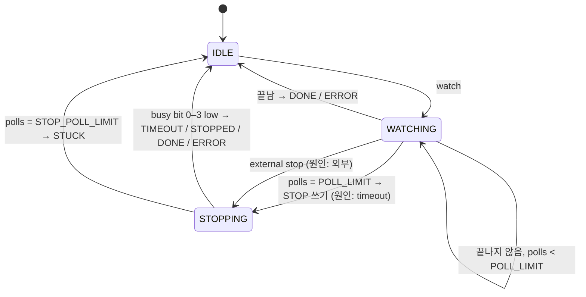

**STOPPING에서 busy가 내려갔을 때의 outcome**

| Stop 원인 | Completion/Error 관찰 | Outcome |
|---|---|---|
| Timeout | (무관) | TIMEOUT |
| 외부 Stop | Completion만 | DONE (task가 Stop 전에 이미 끝났음) |
| 외부 Stop | Error | ERROR |
| 외부 Stop | 없음 | STOPPED |

- 매 poll은 읽은 Interrupt bit를 누적하고, Error를 처음 본 때 Err type (0x64)을 읽는다. 끝날 때 Current descriptor index (0x30)를 읽는다.
- Monitor는 Interrupt를 clear하지 않는다. 다음 Execute 직전에 task 시작 절차가 clear한다.
- **Timer bit는 task를 끝내지 않는다.** Outcome에 기록만 된다.
- Busy가 내려갔지만 Completion도 Error도 없으면(예: Interrupt enable이 꺼짐) task는 끝난 것이 아니다. Timeout 경로로 가서 TIMEOUT으로 끝나며, 기록된 Interrupt bit가 이유를 보여준다.
- Error와 Completion interrupt는 Interrupt enable (0x74)에서 켜져 있어야 한다. 초기화 시 켠다([7.2](#72-startup-sequence)).

**Outcome**

| Outcome | 의미 | 함께 담는 정보 |
|---|---|---|
| DONE | Completion으로 끝남, Error 없음 | Interrupt bit |
| ERROR | Error로 끝남 | Err type, Current descriptor index |
| TIMEOUT | POLL_LIMIT 안에 끝나지 않음, STOP 후 busy 내려감 | Current descriptor index |
| STOPPED | 외부 Stop 후 busy 내려감, Completion/Error 없음 | Current descriptor index |
| STUCK | STOP 후에도 busy가 내려가지 않음 | Status |

#### 5.2.4 TGTM Access

CSR read/write와 (memory, index, word) 단위 DM/UM/RM read/write, 그리고 DM/UM으로의 block copy, RM에서의 entry read를 제공한다. 주소 계산(base + offset, index × entry 크기 + word × 4)만 하며, busy 규칙이나 정책은 판단하지 않는다(판단은 호출자 책임). Register offset과 memory geometry는 [12.2](#122-tgtm-reference)의 값을 한 곳에서 정의한다.

#### 5.2.5 Debug Status Block

FCPU memory의 고정 주소(TBD-17)에 있는 고정 layout(TBD-18)의 기록. 각 module은 자기 field만 쓴다.

| 쓰는 module | Field |
|---|---|
| Scheduler | Sequence open, expected sequence number, pending 여부, counter(Mailbox request 수, Queued request 수, sequence error 수, 거절 수) |
| Executor | Workload state, origin, sequence number, task k / n, 마지막 outcome, stuck flag, counter(task 수) |
| Monitor | Watch 상태, poll 횟수, counter(timeout 수, stuck 수) |

ICPU는 현재 FCPU memory를 읽을 수 없다. Layout을 고정해 두는 이유는, 나중에 Mailbox "read status" request를 추가하거나 block을 shared memory로 옮기는 변경을 작게 하기 위해서이다.

---

## 6. Runtime View

표기: S = scheduler, E = executor, M = monitor.

### 6.1 Main Loop and Atomic Steps

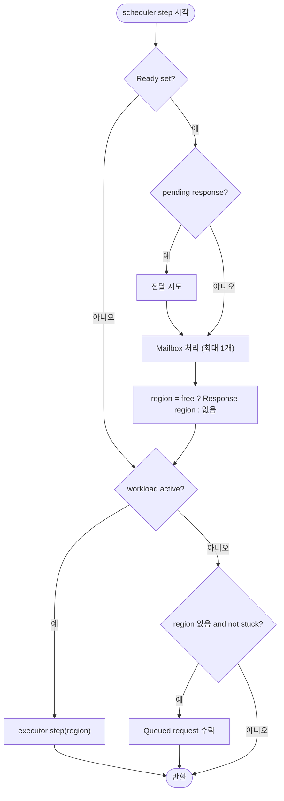

Ready가 clear일 때 region은 항상 "없음"이므로 수락은 일어나지 않고, executor는 region이 필요 없는 step(WAIT_TASK poll, NEXT_TASK 준비)만 진행한다.

### 6.2 Mailbox: TGTM Memory Read/Write

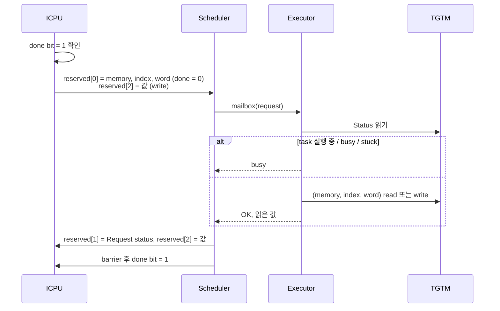

### 6.3 Mailbox: TGTM CSR Read/Write

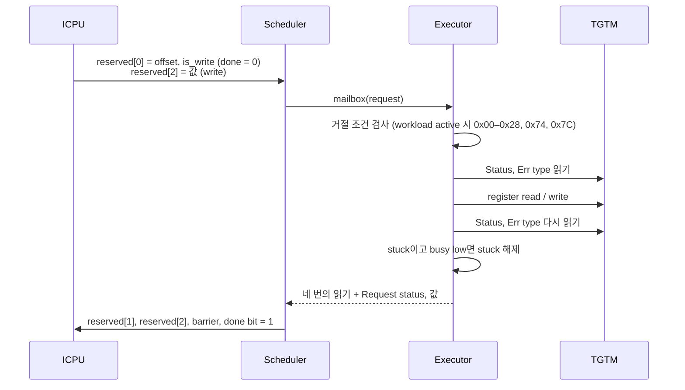

### 6.4 Queued: DIRECT_DM

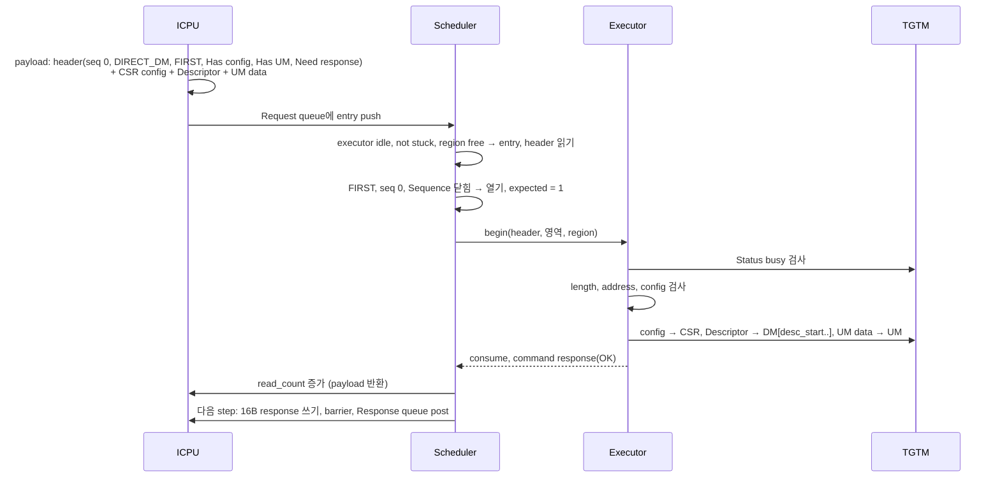

### 6.5 Queued: CONTROL (EXECUTE 외)

```text
S   수락: header, Sequence 검사
E   csr_offset, operation, control value 읽기 → operation table에서 찾기 → CSR 조작 실행
E   consume, command response (Need response일 때, 읽은 값이 있으면 data에)
```

### 6.6 Queued: CONTROL EXECUTE with RM by descriptor

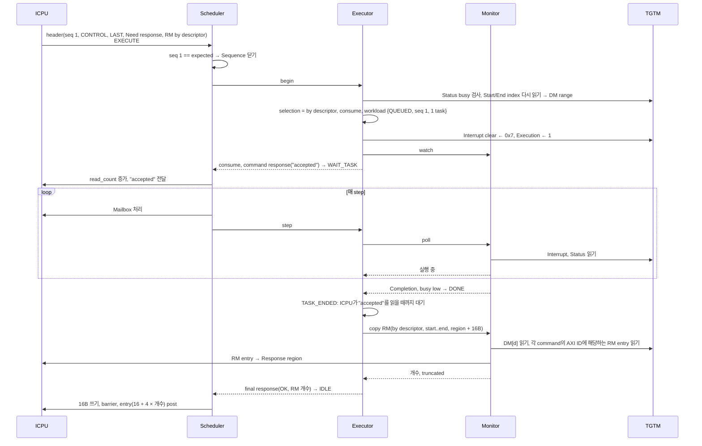

### 6.7 Mailbox Execute

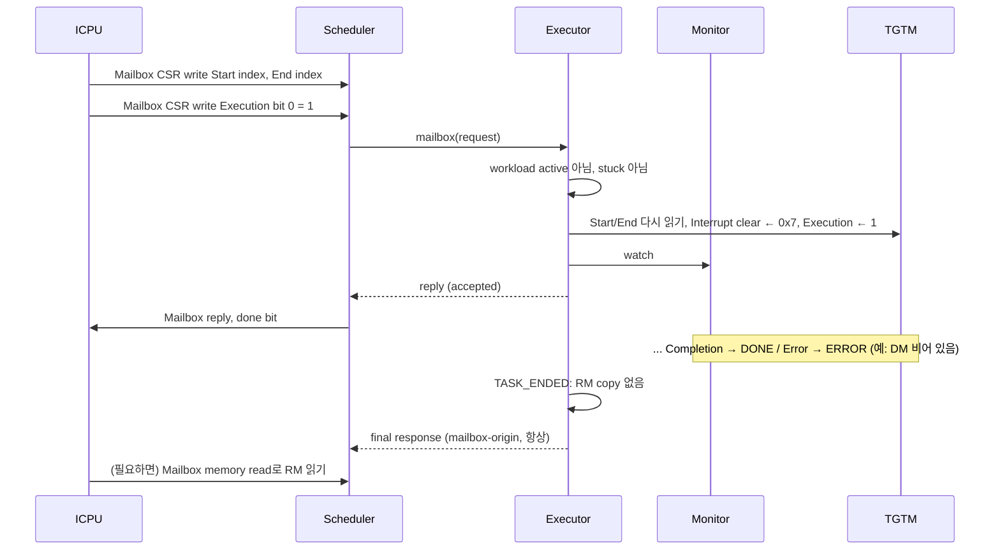

### 6.8 API_SET: Generated Workload (Descriptor 5000개)

```text
E   begin: generator 검증 → N = 5000 → task 2048 / 2048 / 904, consume, command response → NEXT_TASK
E   NEXT_TASK: fill(0, 2048) → start_task(0..2047) → WAIT_TASK … DONE → TASK_ENDED: progress 1/3 → NEXT_TASK
E   NEXT_TASK: fill(0, 2048) → start_task(0..2047) … DONE → progress 2/3
E   NEXT_TASK: fill(0, 904)  → start_task(0..903)  … DONE → RM copy(by descriptor면), final response(OK) → IDLE
```

각 NEXT_TASK와 TASK_ENDED는 별개의 atomic step이므로, task 사이에도 Mailbox가 처리된다.

### 6.9 API_SET: Task 2에서 Error

```text
M   task 2 → ERROR (Err type, Current descriptor index)
E   TASK_ENDED: 더 진행하지 않음 → task 2의 RM copy → final response(execution, task 2/3, Err type, index) → IDLE
```

### 6.10 Timeout and TGTM Stuck

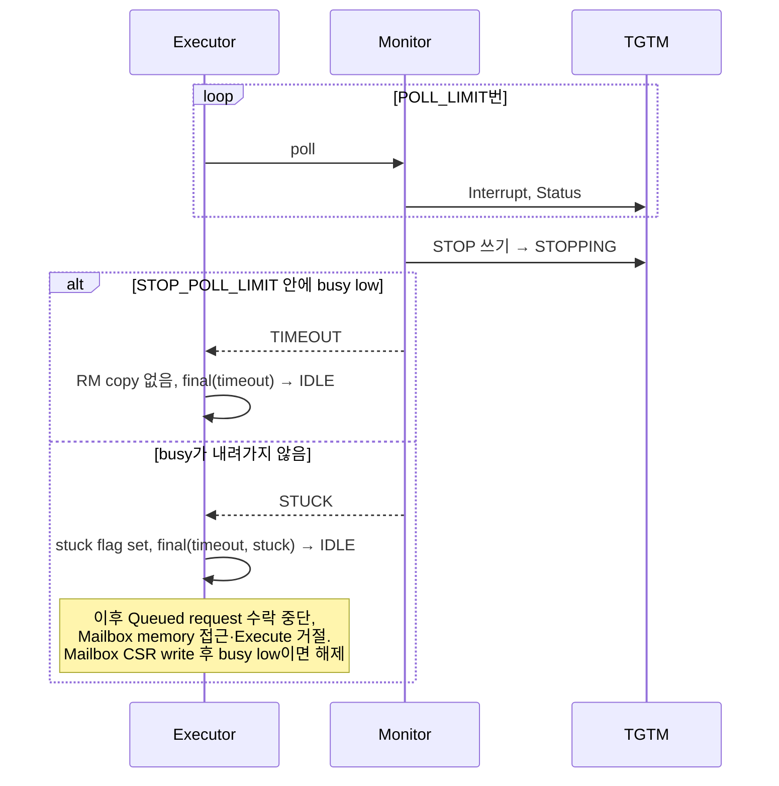

### 6.11 Stop from ICPU

```text
경우 A: task 실행 중
I   Mailbox CSR write STOP
E   쓰기, cancelled ← true, monitor에 external stop → reply
M   STOPPING: busy low, Completion/Error 없음 → STOPPED
E   TASK_ENDED: 남은 task 없음, RM 없음 → final(aborted, 완료 task 수) → IDLE

경우 B: task는 이미 끝났고 TASK_ENDED에서 region 대기 중 (예: DONE)
I   Mailbox CSR write STOP
E   쓰기, cancelled ← true (monitor는 이미 IDLE)
E   region free → 보관한 outcome 그대로 보고: RM copy(selection이 있으면), final(OK, cancelled 표시)
    Generated workload라면 남은 task는 실행하지 않는다

경우 C: Generated, NEXT_TASK (task 사이)
E   cancelled ← true → 다음 step: 다음 task 시작 안 함 → final(aborted, 완료 task k/n) → IDLE

경우 D: workload 없음
E   쓰기만 한다
```

### 6.12 Sequence Error

```text
S   header seq 3, expected 2          → consume, sequence error response(항상), Sequence 닫기
S   FIRST 없음, Sequence 닫혀 있음       → 같음
S   FIRST인데 Sequence 열려 있음         → 같음. ICPU는 FIRST로 다시 시작해야 한다
```

### 6.13 ICPU가 Response를 늦게 읽는 경우 (Backpressure)

```text
S   "accepted" 전달됨, ICPU가 아직 읽지 않음 (read_count ≠ write_count)
M   task 끝남 → E: TASK_ENDED, region이 free가 아님 → 대기, outcome 보관
S   매 step Mailbox는 계속 처리 (Response queue를 쓰지 않으므로)
I   읽음 → read_count 따라잡음 → E: RM copy, final response
```

### 6.14 Ready Cleared

```text
S   Ready clear → Mailbox 처리, 수락, 전달 모두 건너뜀 (error 아님, 보고 없음)
E   WAIT_TASK는 계속 poll한다, TASK_ENDED는 region을 기다린다
```

### 6.15 Workload 중 거절되는 요청 요약

| 요청 | Workload active 중 | Task 실행 중 | Stuck |
|---|---|---|---|
| Queued request | 수락하지 않음(queue에서 대기) | 수락하지 않음 | 수락하지 않음 |
| Mailbox memory read/write | (task 사이면) 허용, busy 검사 | `busy` | `busy` |
| Mailbox CSR read | 허용 | 허용 | 허용 |
| Mailbox CSR write 0x00–0x28(STOP 외), 0x74, 0x7C | `busy` | `busy` | 허용 |
| Mailbox Execute | `busy` | `busy` | `busy` |
| Mailbox STOP | 허용 + cancel | 허용 + cancel | 허용 |

---

## 7. Deployment View

### 7.1 Infrastructure Level 1

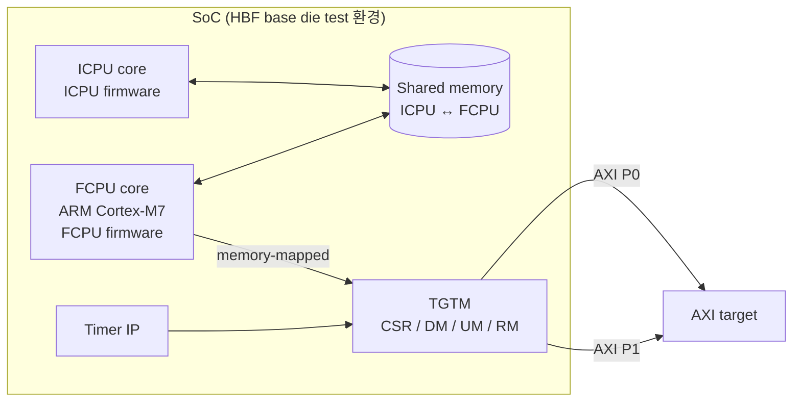

| 요소 | 배치 / 속성 |
|---|---|
| FCPU firmware image | Cortex-M7에서 실행. Code/data 배치(ITCM/DTCM 등): TBD-17 |
| Shared memory | Base address TBD-17. 모든 offset은 base 기준([12.3](#123-icpu--fcpu-interface-reference)). Cache/MPU 속성: TBD-17 |
| TGTM window | CSR, DM, UM, RM의 base address: TBD-17. Memory 속성: device(권장), TBD-17 |
| Debug status block | FCPU memory의 고정 주소: TBD-17 |

### 7.2 Startup Sequence

```text
1. Platform 초기화 (clock, MPU/cache 설정 등; 범위 밖, 속성은 TBD-17)
2. TGTM 초기화: Interrupt enable (0x74) ← Error | Completion
3. Debug status block 초기화
4. Scheduler 초기화 (executor, monitor 포함): Sequence 닫힘, pending 없음, IDLE, stuck 아님
5. Main loop 진입: scheduler step 무한 반복
```

Shared memory(Mailbox done bit, queue counter)의 초기값을 누가 설정하는지는 TBD-16이다. FCPU는 Ready가 set이 될 때까지 shared memory를 건드리지 않으므로, ICPU가 초기화 후 Ready를 set하는 것이 자연스러운 계약이다.

---

## 8. Cross-cutting Concepts

### 8.1 Domain Model

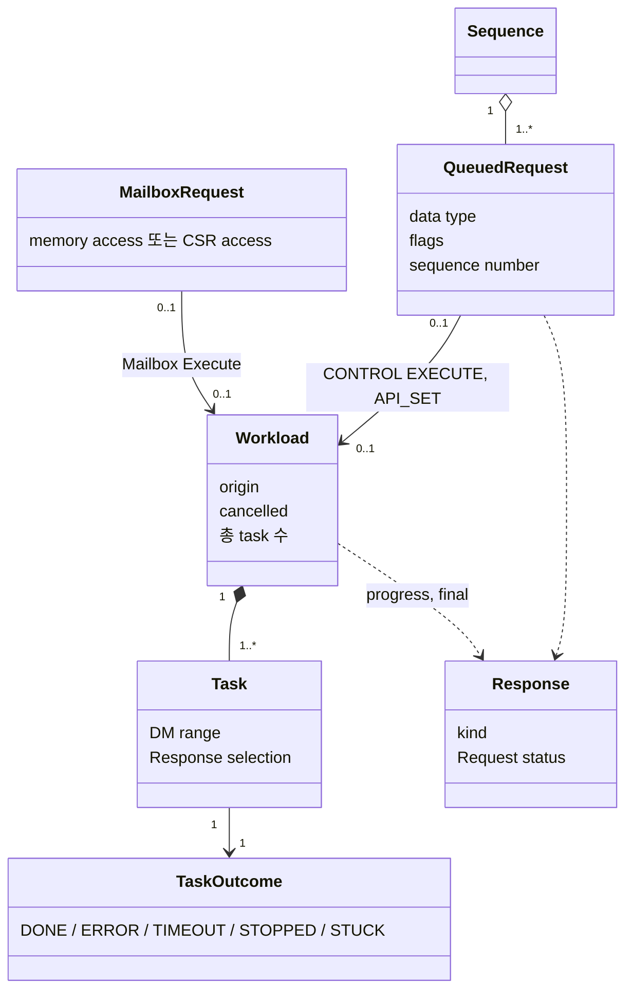

- **Sequence** ⊃ Queued request. 모든 Queued request는 Sequence에 속한다.
- **Workload**는 CONTROL EXECUTE, API_SET, Mailbox Execute만 만든다. DIRECT_DM과 그 밖의 CONTROL은 workload 없이 begin 안에서 끝난다.
- **Task** = Execute 한 번. 모든 task는 workload에 속한다.
- **Task outcome**은 monitor가 정하고, workload의 다음 동작과 Request status는 executor가 정한다.

### 8.2 Cooperative Scheduling and Atomic Steps

FCPU에는 실행 흐름이 하나뿐이다(C1). 그래서 "동시성"은 loop 안에서 작업을 잘게 나누는 것으로 얻는다. **Atomic step**은 중간에 Mailbox가 끼어들지 않는 작업 단위이다.

| Atomic step | 내용 |
|---|---|
| Mailbox request | Peek, 실행, reply, done bit |
| Queued request 처리 | Header·Sequence 검사, request의 작업(copy, CSR 조작, task 시작), consume, command response |
| Task poll | Interrupt, Status 한 번씩 읽기 |
| Task 완료 | RM copy, progress 또는 final response |
| 다음 task 준비(Generated) | 이번 task의 Descriptor를 DM에 생성, Execute |

규칙:
- **Hardware를 기다리지 않는다.** 어떤 step도 busy가 내려가기를 기다리며 loop를 돌지 않는다. 기다림은 "상태를 남기고 반환한 뒤 다음 step에서 다시 확인"으로 표현한다.
- Queued request 처리는 entry를 받는 순간부터 Execute(또는 request 종료)까지 atomic하다. Task 시작과 monitor watch 사이에 Mailbox가 끼어들 수 없으므로, "Execute 됐지만 감시되지 않는 task"는 존재하지 않는다.
- Mailbox 응답 지연의 상한은 가장 긴 atomic step이다: DIRECT_DM 전체 copy(DM 32KB + UM 4KB) 또는 RM copy(최대 2048 entry).

### 8.3 Ownership and Handover of Shared Memory

| 자원 | 소유 규칙 |
|---|---|
| Mailbox | ICPU는 request를 쓰고 done bit를 clear한다. 그 순간부터 done bit를 set할 때까지 word는 FCPU 소유이다. |
| Request payload | Entry가 가리키는 영역은 FCPU가 그 entry를 소비할 때까지 FCPU 소유이다. 소비는 data가 TGTM에 들어가거나 FCPU 상태로 해석된 직후이며, workload가 끝날 때가 아니다. |
| Request queue | ICPU가 write_count를, FCPU가 read_count를 증가시킨다. 비어 있음: 두 값이 같음. |
| Response region | FCPU는 response 하나를 쓰고, ICPU가 읽을 때까지(Response queue read_count가 write_count를 따라잡을 때까지) 다음 response를 쓰지 않는다. |
| Response queue | FCPU가 write_count를, ICPU가 read_count를 증가시킨다. Region이 하나뿐이므로 실제로 queue에 쌓이는 entry는 최대 하나이다. |

Counter의 wrap 방식(32로 나눈 나머지 vs free-running)과 entry `start_addr`의 의미(절대 주소 vs offset)는 TBD-15.

### 8.4 Memory Ordering

Cortex-M7은 쓰기 순서를 보장하지 않으므로, ICPU에 소유권을 넘기거나 ICPU로부터 받는 지점에 memory barrier가 있어야 한다.

| 지점 | 순서 |
|---|---|
| Mailbox reply | reserved[1], reserved[2]를 쓴다 → barrier → done bit set |
| Response 전달 | Response region(RM entry, 16B)을 쓴다 → barrier → Response queue entry를 쓴다 → barrier → write_count 증가 |
| Request queue 소비 | 해당 payload를 마지막으로 읽는다 → barrier → read_count 증가 |
| Request 읽기 | write_count를 읽는다 → barrier → entry와 payload를 읽는다 |
| Mailbox 읽기 | done bit 확인 → barrier → request word 읽기 |

TGTM에 대해서도: Interrupt clear와 Start/End index 쓰기가 Execution 쓰기보다 먼저 TGTM에 도달해야 한다(Device memory 속성이면 보장, 아니면 barrier). 각 region의 memory 속성은 TBD-17.

### 8.5 TGTM Access Safety

1. **Busy 중 memory 접근 금지.** DM, UM, RM은 task가 실행 중이 아니고 Status에서 TGTM busy(bit 0)와 해당 memory의 busy bit(DM bit 1, RM bit 2, UM bit 3)가 모두 low일 때만 접근한다.
2. **CSR은 항상 접근 가능하다.** TGTM이 busy여도 된다.
3. **Execute 전 Interrupt clear.** Task 시작 절차에서만 한다.
4. **Error/Completion interrupt enable 유지.** 초기화 시 켜고, workload 중에는 Mailbox로 바꿀 수 없다.
5. **Workload 중 실행 설정 보호.** 0x00–0x28(STOP 외) Mailbox write는 workload 중 거절한다.

### 8.6 Task Lifecycle Invariants

- 모든 Execute는 task이고, 모든 task는 workload에 속하며, 모든 task는 감시된다.
- Execution register는 task 시작 절차에서만 쓴다. Mailbox Execute도 이 절차를 거친다(Mailbox write를 TGTM에 그대로 전달하지 않는다).
- Workload는 한 번에 하나이다. Workload가 active인 동안 Queued request는 수락되지 않고, Mailbox Execute는 거절된다.
- Monitor는 task당 정확히 한 번 outcome을 돌려준다.
- Stuck 동안에는 새 task를 시작하지 않는다.

### 8.7 Response and Status Reporting

**Response 종류**

| Response | 언제 | RM entry |
|---|---|---|
| Command | Queued request가 처리됨. EXECUTE/API_SET이면 "accepted" | 없음 |
| Progress | Generated workload의 마지막이 아닌 task가 DONE으로 끝남 | 없음 |
| Final | Workload 종료 | QUEUED origin, RM by descriptor, outcome DONE/ERROR일 때 |
| Error | `invalid`, `sequence`, `length`, `address`, `csr`, `unsupported`, `busy`로 거절됨 | 없음 |

**Response 내용**(16B, layout TBD-12): kind, origin(QUEUED / MAILBOX), sequence number, Request status, stuck 표시, cancelled 표시, task k / n, data(CONTROL 읽기 값, 또는 Err type + Current descriptor index), RM entry 개수, truncated 표시.

**보고 규칙**
- FCPU는 보내야 하는 response를 버리지 않는다. Region이 free가 아니면 기다린다.
- Need response가 clear이면 command, progress, OK final을 보내지 않는다. Error, execution, timeout, aborted는 항상 보낸다.
- 한 scheduler step은 최대 하나의 response를 만든다.
- Mailbox reply는 Response queue를 쓰지 않는다. Mailbox Execute의 결과만 Response queue로 간다(mailbox-origin).

**Request status 결정**

| Status | 의미 |
|---|---|
| OK | 성공 |
| invalid | 잘못된 header, data type에 맞지 않는 flag, RM by descriptor without Need response, generator parameter 오류 |
| unsupported | 알 수 없는 CONTROL operation, memory type, generator |
| address | Index/word/range가 범위 밖 |
| length | Entry length가 header(desc_count, config, UM)와 맞지 않음 |
| sequence | Sequence error |
| csr | CSR config 검사 실패 |
| execution | Task가 Error로 끝남 |
| timeout | Task timeout. Stuck 표시와 함께 쓰면 TGTM stuck |
| busy | 거절: task 실행 중, memory busy, workload active, 또는 stuck |
| aborted | Workload가 STOP으로 cancel됨 |

### 8.8 Error Handling and Recovery

| 상황 | 처리 | 복구 |
|---|---|---|
| Header/length/address/config 오류 | 검사 후 적용 원칙에 따라 TGTM을 건드리지 않고 consume, error response | 없음(ICPU가 수정 후 재전송) |
| Sequence error | consume, `sequence` response, Sequence 닫기 | ICPU가 FIRST로 새 Sequence 시작 |
| Task Error | Final(execution) + Err type, index, RM(요구 시). Generated면 거기서 멈춤 | 없음 |
| Timeout | STOP 쓰기, final(timeout) | 자동 |
| Stuck | Stuck flag, final(timeout, stuck). Queued 수락 중단, Mailbox memory 접근/Execute 거절 | ICPU가 Mailbox CSR write(예: STOP, RESUME, reset 성격의 register)로 복구 시도. 그 write 후 busy가 low로 읽히면 해제 |
| 외부 Stop | Cancel. 이미 끝난 outcome은 유지, 아니면 aborted | 자동 |
| Ready clear | Shared memory 작업 중단, hardware 측 진행만 계속 | Ready set 시 재개 |

### 8.9 Response Selection and RM Copy

RM은 AXI ID의 하위 bit로 index되므로, task의 Descriptor를 알면 각 command의 Response가 RM의 어디에 있는지 계산할 수 있다. **RM by descriptor**는 이 계산으로 Response selection을 정한다.

```text
copy_rm(selection, dm_start, dm_end, 대상):
    if selection 없음: return (0, false)
    id_state ← task 시작 상태                    # "task 전체에 걸쳐 순차" 같은 ID scheme용
    n ← 0
    for d in dm_start .. dm_end:
        desc ← DM[d] 읽기                         # task가 끝났으므로 DM 접근 안전
        repeat desc.nReq 번:
            id ← desc의 ID scheme에 따른 다음 AXI ID (id_state 갱신)
            if 대상이 가득 참: return (n, truncated = true)
            대상[n] ← RM[id의 하위 13 bit]; n ← n + 1
    return (n, false)
```

- Entry는 Descriptor 순서, command마다 하나이다. 두 command가 같은 RM index를 공유하면 같은 entry가 두 번 들어간다. ICPU는 **위치**로 entry와 command를 대응시킨다.
- Task 안에서 RM entry가 덮어써질 수 있으므로(ID 공유), 복사되는 값은 그 index에 마지막으로 도착한 Response이다.
- LOOP > 1이면 RM에는 마지막 loop의 Response만 남는다.
- 대상 용량은 Response region에서 16B를 뺀 2048 entry이다. 넘치면 들어가는 만큼 복사하고 truncated로 표시한다.
- Selection은 DM에서 task 뒤에 계산한다(Generated workload도 DM이 진실이다).
- Mailbox Execute, TIMEOUT, STOPPED, STUCK 후에는 호출하지 않는다.
- ID scheme 목록과 AXI ID 계산식, Descriptor bit layout: TBD-01, TBD-02.

### 8.10 Extensibility

| 확장 | 변경 범위 |
|---|---|
| 새 generator | Generator 계약(begin, fill)을 만족하는 정의 하나 + API 이름 table 한 줄 |
| 새 CONTROL operation | Operation table 한 줄 + 그 CSR 절차 |
| 새 Mailbox request 종류(예: read status) | Mailbox word 해석(scheduler) + executor Mailbox 진입점의 한 분기 |
| Timeout 정책 변경 | Monitor 안의 tunable만 |

### 8.11 Diagnosability

- **CSR Mailbox reply**는 항상 접근 전후의 Status와 Err type을 담는다. ICPU는 한 번의 접근으로 "그때 TGTM이 무엇을 하고 있었는지"를 안다.
- **Final response**는 실패 시 Err type과 Current descriptor index를 담는다. Current loop, Current nReq, port counter는 ICPU가 Mailbox CSR read로 읽는다.
- **Monitor outcome**은 관찰한 Interrupt bit 전체를 담는다(Timer bit, busy는 내려갔으나 Completion이 없던 경우의 진단).
- **Debug status block**([5.2.5](#525-debug-status-block)).

### 8.12 Tunables

| 이름 | 의미 | 값 |
|---|---|---|
| POLL_LIMIT | Task를 timeout으로 판정하기까지의 poll 횟수 | TBD-14 |
| STOP_POLL_LIMIT | STOP 후 stuck으로 판정하기까지의 poll 횟수 | TBD-14 |
| Task 최대 크기 | Generated workload에서 task 하나의 최대 Descriptor 수 | 2048 (DM 크기) |
| RM copy 최대 entry 수 | Response region에 들어가는 RM entry 수 | 2048 |

---

## 9. Architecture Decisions

ADR 파일은 `docs/adr/`에 있다. 아래 D-xx 중 ADR이 없는 것은 이 문서가 기록 장소이다. **"신규"** 로 표시된 결정은 이 문서 작성 중에 새로 정해졌으므로 검토가 필요하다.

| ID | 결정 | 이유 | 대안과 기각 이유 |
|---|---|---|---|
| ADR-0001 | *(superseded by ADR-0002)* Scheduler 아래에 세 개의 독립 leaf(handler, executor, monitor) | — | Task 뒤 결정 logic이 transport code 옆(scheduler)에 놓이게 되어 기각 |
| D-01 / ADR-0002 | **Scheduler가 executor를, executor가 monitor를 소유하는 tree.** Scheduler는 언제, executor는 무엇을, monitor는 task 하나를 감시 | 개념 하나가 한 module에 모인다. Mailbox Execute와 Mailbox memory 접근이 executor 상태(task 실행 여부)에 의존하므로 Mailbox도 executor를 통해 들어간다 | 별도 Mailbox service: executor 상태를 공유해야 해서 기각 |
| D-02 | **No staging.** Bulk data는 shared memory ↔ TGTM 직접 복사 | Payload(0x8000)와 RM(32KB)은 FCPU memory에 담기에 너무 큼, layout은 고정 | Request와 RM을 FCPU struct에 복사: 크기 때문에 기각 |
| D-03 | **Response slot 하나 + backpressure** | Response region이 하나뿐(고정 layout). 버리지 않는 것이 최우선 | Region 분할: layout 변경 필요. 덮어쓰기: 결과 손실 |
| D-04 | **Timeout은 loop(poll) 횟수** | Timer 의존 없이 단순. 현재 code와 같음 | TGTM Timer register: 사용 가능하나 채택하지 않음. 단점은 [11.1](#111-risks) R1 |
| D-05 | **Workload는 한 번에 하나.** Workload 중 Queued 수락 중단 | TGTM은 task 하나만 실행 가능, 순서 보장 | Workload 중 비실행 request(DIRECT_DM) 처리: DM이 실행 중 바뀔 위험 |
| D-06 | **Mailbox Execute는 디버그 경로, RM 없음** | Selection 정보가 없음. ICPU가 필요하면 Mailbox로 RM 읽음 | — |
| D-07 | **신규.** CONTROL EXECUTE의 DM range는 CSR Start/End index를 다시 읽어 정하고, `start ≤ end ≤ 2047`을 검사한다 | DIRECT_DM config나 CONTROL로 이미 설정된 range를 쓰는 것이 protocol상 자연스럽다. RM copy에 유효한 range가 필요 | Control value에 range 인코딩: protocol 변경. 마지막 DIRECT_DM range 기억: 숨은 상태 |
| D-08 | **신규.** 외부 Stop은 이미 끝난 task의 outcome을 덮어쓰지 않고, 남은 task만 막는다. 실행 중 task에 대한 외부 Stop은 monitor를 STOPPING으로 보낸다 | 정상 완료한 task를 aborted로 보고하면 결과를 잃는다. Monitor가 Stop을 모르면 timeout까지 기다리게 된다 | 항상 aborted: 정보 손실 |
| D-09 | **Workload 중 Mailbox CSR write 일부 거절**(0x00–0x28 중 STOP 외, 0x74, 0x7C) | 실행 설정과 Interrupt 감시 보호 | 모두 허용: monitor가 task 끝을 놓칠 수 있음 |
| D-10 | **Generated workload는 DONE이 아닌 첫 task에서 멈춤** | 실패 후 계속하면 원인 분석이 어렵고 RM이 덮어써짐 | 끝까지 실행 후 요약 보고 |
| D-11 | **RM by descriptor: Descriptor 순서, 중복 유지, task 후 DM에서 계산, 넘치면 truncate** | ICPU가 위치로 대응 가능, 별도 selection 저장 불필요 | Index 정렬·중복 제거: command 대응이 깨짐 |
| D-12 | **신규.** DIRECT_DM은 검사 후 적용(validate-then-apply) | 거절된 request가 TGTM을 반쯤 바꿔 두지 않게 | 순차 적용: 부분 적용 상태 발생 |
| D-13 | **신규.** RM by descriptor + Need response clear는 `invalid` | RM을 담을 OK final이 억제되어 의미가 없음 | 조용히 무시 |
| D-14 | **Stuck 정책**: Queued 수락 중단, Mailbox memory/Execute 거절, Mailbox CSR write 후 busy low이면 해제 | 멈추지 않는 TGTM에 새 task를 주지 않되 ICPU에게 복구 수단을 남김 | 자동 reset: 복구 절차 미정 |
| D-15 | **Sequence error는 Sequence를 닫음** | 이후 request의 순서를 추측하지 않음 | 다음 번호로 재동기화 |

---

## 10. Quality Requirements

### 10.1 Quality Tree

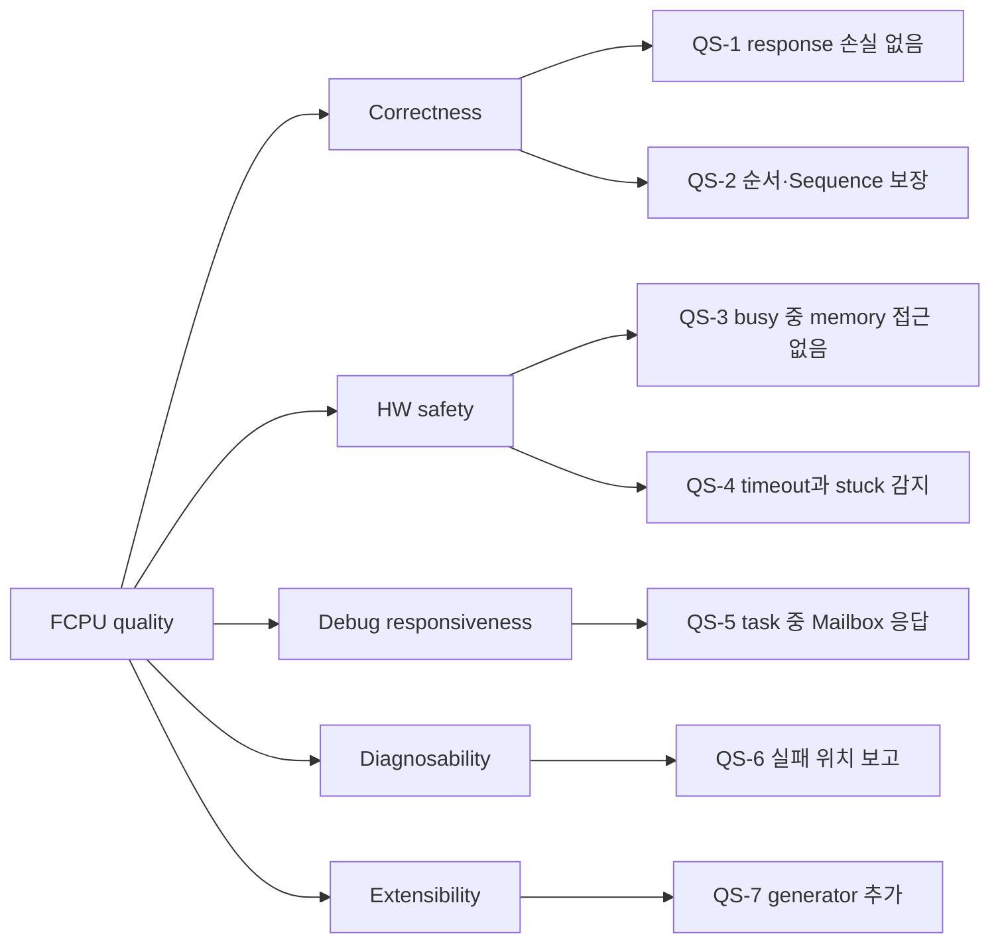

### 10.2 Quality Scenarios

| ID | Quality | 자극 | 기대 반응 | 측정 |
|---|---|---|---|---|
| QS-1 | Correctness | ICPU가 "accepted"를 읽기 전에 task가 끝남 | Outcome을 보관하고 ICPU가 읽은 뒤 final을 보냄 | Response 손실 0 |
| QS-2 | Correctness | Queue에 seq 0, 2가 들어옴 | seq 2를 실행하지 않고 `sequence` 응답, Sequence 닫음 | 순서 위반 실행 0 |
| QS-3 | HW safety | Task 실행 중 Mailbox DM read | `busy`로 거절, TGTM memory 접근 없음 | Busy 중 memory 접근 0 |
| QS-4 | HW safety | TGTM이 끝나지 않음 | POLL_LIMIT 후 STOP, STOP_POLL_LIMIT 후 stuck, 이후 task 차단 | 모든 task가 유한 시간 안에 outcome을 가짐 |
| QS-5 | Responsiveness | 긴 task 실행 중 Mailbox CSR read | 다음 scheduler step 안에 reply | 지연 ≤ 가장 긴 atomic step(값 TBD) |
| QS-6 | Diagnosability | Task가 Error로 끝남 | Final에 Err type, Current descriptor index | 100% |
| QS-7 | Extensibility | 새 generator 추가 | Generator 정의 하나 + table 한 줄, 다른 module 변경 없음 | 수정 module 수 1 |

---

## 11. Risks and Technical Debt

### 11.1 Risks

| ID | Risk | 영향 | 대응 |
|---|---|---|---|
| R1 | Timeout이 loop 횟수라서 실제 시간이 loop당 작업량(Mailbox 빈도, copy 크기)에 따라 변한다 | 긴 task가 잘못 timeout되거나, 너무 늦게 감지됨 | POLL_LIMIT을 여유 있게 설정. 필요 시 TGTM Timer register 기반으로 전환(monitor만 변경) |
| R2 | 긴 atomic step(DIRECT_DM 36KB copy, RM 2048 entry copy) 동안 Mailbox가 기다린다 | Mailbox 응답 지연 | 필요하면 copy를 여러 step으로 분할(현재는 하지 않음) |
| R3 | Response slot 하나 → ICPU가 느리면 workload 완료 보고가 지연 | 처리량 저하 | ICPU가 response를 즉시 읽도록 protocol 문서화 |
| R4 | RM은 AXI ID 하위 bit로 index → 같은 task 안에서 덮어써짐 | 복사된 RM이 일부 command의 결과가 아님 | ID scheme을 선택해 충돌 회피(ICPU 책임), 위치 기반 대응 |
| R5 | Stuck 복구가 ICPU의 CSR write에 의존하며 복구 절차가 정해지지 않음 | TGTM이 영구 차단될 수 있음 | RESUME 등 의미 확정 후 복구 절차 정의(TBD-20) |
| R6 | TGTM이 STOP에 대해 Completion/Error를 올리는지 모름 | 외부 Stop outcome 판정(STOPPED vs DONE/ERROR)이 달라질 수 있음 | TBD-19 확인 |
| R7 | ICPU가 workload 밖에서 Interrupt enable을 끄면 이후 모든 task가 timeout | 오진단 | 기록된 Interrupt bit로 진단 가능. 필요 시 task 시작 절차에서 enable 재확인 |
| R8 | TGTM spec 부재로 많은 사실이 TBD | 구현 시 추측 위험 | 11.3의 TBD를 HW 담당자와 확정 |

### 11.2 Technical Debt

| ID | 항목 |
|---|---|
| TD1 | ICPU가 debug status block을 읽을 수 없다(Mailbox "read status" 미구현). |
| TD2 | API_SET은 설계만 있고 production이 아니다. |
| TD3 | RESUME의 동작과 Stop 정책의 관계가 정해지지 않았다. |
| TD4 | 기존 code에는 sequence 종료 flag가 END_SEQUENCE로 되어 있으나 이 설계는 FIRST/LAST를 쓴다. 기존 ICPU와의 호환성 확인이 필요하다. |

### 11.3 Open Items (TBD)

| ID | 항목 | 영향 범위 |
|---|---|---|
| TBD-01 | Descriptor 16B의 bit layout(AXI command field, nReq, addr_inc, pattern, compare, ID scheme) | RM copy, generator |
| TBD-02 | ID scheme 목록과 각 scheme의 AXI ID 계산식. RM index에 쓰이는 하위 bit 수(8192 entry에서 13 bit로 추정) | RM copy |
| TBD-03 | UM의 Mailbox addressing(index 크기, word), UM data copy 시작 offset | Mailbox, DIRECT_DM |
| TBD-04 | CSR 의미: RESUME, LOOP, Addr increase, Error level, Stop on failure, Master port encoding, Timer reset, Loopback enable. STOP에 쓰는 값. Err type code 목록 | TGTM access, 진단 |
| TBD-05 | Mailbox word bit 위치: reserved[0] (memory 형식, CSR 형식, done bit 31), reserved[1] CSR reply의 4 reads(22 bit)와 Request status packing | Scheduler |
| TBD-06 | Request status 수치 값 | 전체 |
| TBD-07 | Request payload header bit 위치: data type, sequence number 폭, desc_count, desc_start | Scheduler |
| TBD-08 | Data type 수치 값 | Scheduler |
| TBD-09 | CSR config: 대상 register 집합, 크기(현재 code는 16B), 검사 규칙 | DIRECT_DM |
| TBD-10 | UM data 길이 규칙(최대 4KB, 정렬) | DIRECT_DM |
| TBD-11 | CONTROL operation 목록과 code, EXECUTE code, csr_offset의 쓰임 | CONTROL |
| TBD-12 | 16B response layout | Scheduler, ICPU |
| TBD-13 | API_SET parameter 형식(`seq_write`, `seq_read`, `rand_read`) | API_SET |
| TBD-14 | POLL_LIMIT, STOP_POLL_LIMIT 값 | Monitor |
| TBD-15 | Queue counter wrap 방식, entry `start_addr`의 의미(절대 주소 / offset) | Scheduler |
| TBD-16 | Ready의 값 의미, boot 시 shared memory(done bit, counter) 초기화 주체 | Scheduler, 7.2 |
| TBD-17 | Memory map: shared memory base, TGTM CSR/DM/UM/RM base, 각 region의 cache/MPU 속성, FCPU code/data 배치, debug status block 주소 | 7, 8.4 |
| TBD-18 | Debug status block layout | 5.2.5 |
| TBD-19 | STOP 시 TGTM이 Completion/Error를 set하는지 | Monitor |
| TBD-20 | RESUME 동작, stuck 복구 절차 | Executor, 8.8 |
| TBD-21 | DIRECT_DM에서 desc_count = 0 허용 여부(config/UM만 load) | DIRECT_DM |
| TBD-22 | Req res count, Timer register 단위, port counter reset 방식 | 진단 |

---

## 12. Glossary

### 12.1 Domain Terms

**Hardware**

| Term | 정의 |
|---|---|
| TGTM | Traffic Generator / Traffic Monitor. Descriptor에 기술된 AXI traffic을 발생시키고 response를 RM에 기록하는 hardware block. |
| DM (Descriptor Memory) | Descriptor 2048개(각 16B)를 담는 32KB TGTM memory. |
| RM (Response Memory) | Response 8192개(각 4B)를 담는 32KB TGTM memory. 돌아온 response의 AXI ID(= request의 ID) 하위 bit로 index되므로 한 task 안에서 entry가 덮어써질 수 있다. |
| UM (User Memory) | AXI write command용 사용자 지정 write data를 담는 4KB TGTM memory. |
| CSR | TGTM register 집합(32-bit). Control, status, port counter, interrupt. TGTM이 busy여도 항상 접근 가능하다. |
| Descriptor | DM entry 하나(16B). AXI command field와 nReq(생성할 command 수), addr_inc, pattern, compare, ID scheme을 담는다. |
| ID scheme | Descriptor의 각 command가 AXI ID를 얻는 방식(예: 주소 하위 bit, task 전체에 걸쳐 순차). RM이 AXI ID로 index되므로 각 command의 Response가 RM의 어디에 놓일지를 결정한다. |
| Response | RM entry 하나(4B). AXI response의 일부: read data 2B, AXI ID 상위 bit, compare 결과(cp). |
| Port | TGTM의 두 AXI master port P0, P1. Master port register가 제한하지 않으면 traffic은 두 port를 번갈아 쓴다. |
| Interrupt | TGTM event bit 세 개: Error, Completion, Timer. Enable된 것만 set되고 FCPU가 clear할 때까지 유지된다. 전달되지 않고 poll된다. |

**Firmware**

| Term | 정의 |
|---|---|
| ICPU | 사용자를 마주하는 CPU. CLI 입력을 parsing해 FCPU에 request를 보내고 결과를 보고한다. |
| FCPU | TGTM을 제어하는 CPU. ICPU와 TGTM 사이에서 request와 response를 옮기고, Descriptor를 생성하며, TGTM의 완료와 error를 감시한다. |
| Scheduler | FCPU의 최상위 module. Transport를 소유하고 언제 무엇이 실행될지 결정한다. |
| Executor | Request의 의미를 실행하고 workload와 task를 진행하는 module. Scheduler가 소유한다. |
| Monitor | 실행 중인 task 하나를 감시하고 outcome을 돌려주는 module. Executor가 소유한다. |
| Atomic step | 중간에 Mailbox가 끼어들지 않는 FCPU 작업 단위. |
| Mailbox request | Mailbox로 들어와 task 실행 중에도 즉시 처리되는 ICPU request. TGTM memory(DM/UM/RM, index와 word로 지정) read/write 또는 CSR read/write. *Avoid*: direct request |
| Queued request | Request queue로 들어오는 ICPU request. Queue 순서대로 한 번에 하나씩 처리되며 workload가 active인 동안에는 수락되지 않는다. Data type은 DIRECT_DM, CONTROL, API_SET. 모두 Sequence에 속한다. |
| DIRECT_DM request | TGTM을 시작하지 않고 load만 하는 Queued request. 선택적 CSR config(Has config), DM에 복사할 Descriptor(start index부터), 선택적 UM data(Has UM). *Avoid*: supplied workload |
| CONTROL request | Queue 순서에 맞춰 control operation 하나(CSR 접근 또는 정해진 CSR 접근 묶음)를 실행하는 Queued request. EXECUTE operation은 workload를 시작한다. |
| API_SET request | Generator와 parameter를 지정하는 Queued request. FCPU가 Descriptor를 직접 만들어 Generated workload로 실행한다. 아직 production이 아니다. |
| Sequence | Queued request의 순서 있는 묶음. FIRST request가 sequence number 0으로 열고, 이후 1씩 증가하며, LAST request가 닫는다. 단독 request는 FIRST와 LAST를 모두 가진다. Sequence error(Sequence가 없는데 FIRST가 아님, 열려 있는데 FIRST, 번호 어긋남)는 열린 Sequence를 닫는다. *Avoid*: END_SEQUENCE |
| TGTM workload | FCPU가 하나의 단위로 실행·추적하는 하나 이상의 TGTM task. CONTROL EXECUTE와 Mailbox Execute는 DM에 이미 있는 Descriptor로 single-task workload를, API_SET은 Generated workload를 만든다. *Avoid*: job |
| Generated workload | FCPU가 API_SET parameter로 Descriptor를 만드는 workload. 여러 task가 될 수 있다. *Avoid*: auto workload |
| Generator | API_SET에서 Descriptor를 만드는 단위. 검증(총 Descriptor 수)과 DM 채우기 두 operation을 가진다. |
| Mailbox Execute | Execution bit 0에 1을 쓰는 Mailbox CSR write. Workload active 중이면 거절된다. 아니면 DM에 있는 Descriptor로 single-task workload를 만든다. RM은 복사하지 않는 디버그 경로. *Avoid*: raw execute |
| Response selection | Task가 끝난 뒤 Response region으로 복사할 RM entry. RM by descriptor면 task의 Descriptor들이 command에 준 AXI ID 위치의 RM entry, 아니면 비어 있다. 넘치면 들어가는 만큼만 복사하고 truncated로 표시한다. |
| TGTM task | TGTM 실행 한 번: Execute 한 번에 대해 start index부터 end index까지의 Descriptor. 모든 Execute는 task를 시작하고 모든 task는 workload에 속한다. *Avoid*: window, run, chunk |
| Execute | Execution register bit 0에 1을 쓰는 것. 현재 CSR의 start/end index로 task를 시작한다. 매 Execute 전에 모든 Interrupt를 clear한다. |
| Stop | STOP register를 써서 TGTM을 강제 정지시키는 것. Timeout 시 FCPU가 쓰고, ICPU도 Mailbox CSR write로 쓸 수 있으며 이때 active workload가 cancel된다. 이미 끝난 task의 outcome은 바뀌지 않는다. |
| TGTM stuck | 강제 Stop 후에도 busy가 내려가지 않은 상태. CSR write로 복구될 때까지 FCPU는 새 task를 거부한다. |
| Task outcome | 감시된 task가 끝난 방식: DONE, ERROR, TIMEOUT, STOPPED, STUCK. |
| Held outcome | Executor가 TASK_ENDED에서 처리할 때까지 보관하는 task outcome. |

**ICPU ↔ FCPU channels**

| Term | 정의 |
|---|---|
| Ready | ICPU가 설정하는 shared memory word. FCPU는 shared memory 접근 전마다 확인한다. |
| Mailbox | Mailbox request 하나를 담는 shared memory word 3개. FCPU가 같은 word에 reply를 쓰고 done bit로 ICPU에 돌려준다. *Avoid*: direct queue |
| Request queue | ICPU → FCPU Queued request를 나르는 32 entry queue. Entry는 Request payload 안의 주소와 길이만 담는다. *Avoid*: workload queue |
| Request payload | Request queue entry가 가리키는 shared memory 영역(0x8010B). *Avoid*: workload buffer |
| Response queue | FCPU → ICPU response를 나르는 32 entry queue. Mailbox reply는 쓰지 않는다. |
| Response region | Response queue entry가 가리키는 shared memory 영역(0x2010B). 16B response + RM entry 2048개. *Avoid*: response buffer |
| Request status | Mailbox reply와 response의 결과 code. |
| Request flags | Queued request header의 8 flag bit. |
| Need response | Command, progress, OK final response를 요구하는 flag. Error는 항상 보낸다. |
| RM by descriptor | Task의 Descriptor에 해당하는 RM entry를 final response에 담으라는 flag. |
| UART channel | UART text용 shared memory 영역. 이 설계의 범위 밖. |

### 12.2 TGTM Reference

**Memories**

| Memory | 크기 | Entry | Mailbox addressing | 내용 |
|---|---|---|---|---|
| DM | 32KB | 2048 × 16B | index 0–2047, word 0–3 | Descriptor (bit layout TBD-01) |
| RM | 32KB | 8192 × 4B | index 0–8191, word 0 | Response: read data 2B, AXI ID 상위 bit, cp |
| UM | 4KB | TBD-03 | TBD-03 | AXI write data |

**CSR map** (32-bit registers)

| Offset | 이름 | 분류 | 의미 |
|---|---|---|---|
| 0x00 | Start index | Control | 다음 task의 첫 DM Descriptor |
| 0x04 | End index | Control | 다음 task의 마지막 DM Descriptor(포함) |
| 0x08 | Execution | Control | bit 0에 1을 쓰면 start..end로 task 시작 |
| 0x0C | STOP | Control | 실행 중 task 강제 정지(쓰는 값 TBD-04) |
| 0x10 | RESUME | Control | TBD-04 |
| 0x14 | LOOP | Control | TBD-04 (LOOP > 1이면 RM에는 마지막 loop만 남음) |
| 0x18 | Addr increase | Control | TBD-04 |
| 0x1C | Error level | Control | TBD-04 |
| 0x20 | Stop on failure | Control | TBD-04 |
| 0x24 | Master port | Control | P0 / P1 중 사용할 port. 기본: 둘 다 round-robin. Encoding TBD-04 |
| 0x28 | Timer reset | Control | TBD-04 |
| 0x2C | Status | Status | bit 0 TGTM busy, bit 1 DM busy, bit 2 RM busy, bit 3 UM busy |
| 0x30 | Current descriptor index | Status | 현재(또는 멈춘) Descriptor index |
| 0x34 | Current loop | Status | 현재 loop |
| 0x38 | Current nReq | Status | 현재 Descriptor 안의 command 위치 |
| 0x3C | Timer | Status | Timer IP 기반 값(단위 TBD-22) |
| 0x40 | P0 AW count | Port counter | |
| 0x44 | P0 W count | Port counter | |
| 0x48 | P0 AR count | Port counter | |
| 0x4C | P0 R count | Port counter | |
| 0x50 | P1 AW count | Port counter | |
| 0x54 | P1 W count | Port counter | |
| 0x58 | P1 AR count | Port counter | |
| 0x5C | P1 R count | Port counter | |
| 0x60 | Req res count | Status | TBD-22 |
| 0x64 | Err type | Status | 7 bit. Code 목록 TBD-04 |
| 0x68 | P0 B count | Port counter | |
| 0x6C | P1 B count | Port counter | |
| 0x70 | Loopback enable | Control | TBD-04 |
| 0x74 | Interrupt enable | Interrupt | 켜진 interrupt (bit 배치 아래) |
| 0x78 | Interrupt | Interrupt | Set된 interrupt bit. FCPU가 poll |
| 0x7C | Interrupt clear | Interrupt | bit를 쓰면 Interrupt의 해당 bit clear |

**Interrupt bit** (0x74, 0x78, 0x7C 공통)

| Bit | 이름 | 의미 |
|---|---|---|
| 0 | Error | Task가 error로 끝남(Err type 참고) |
| 1 | Completion | Task가 완료됨 |
| 2 | Timer | Timer event. Task를 끝내지 않음 |

**Status bit** (0x2C)

| Bit | 이름 | Mailbox reply의 4 reads에 포함 |
|---|---|---|
| 0 | TGTM busy | 예 |
| 1 | DM busy | 예 |
| 2 | RM busy | 예 |
| 3 | UM busy | 예 |

**Task 절차**(hardware 관점): Interrupt clear ← 0x7 → Start/End index 설정(0–2047) → Execution bit 0 ← 1, TGTM busy → AXI traffic 발생, RM에 Response 기록 → Completion 또는 Error set, busy bit 내려감.

### 12.3 ICPU ↔ FCPU Interface Reference

**Shared memory layout** (field가 packed이고 크기가 byte라고 가정한 offset. 공유 header와 대조 필요)

| Field | 용어 | Offset | 크기 | 방향 |
|---|---|---|---|---|
| `ready` | Ready | 0x0000 | 4 | ICPU 설정 |
| `reserved[3]` | Mailbox | 0x0004 | 12 | 양방향 |
| `request_queue` | Request queue | 0x0010 | 0x110 | ICPU → FCPU |
| `response_queue` | Response queue | 0x0120 | 0x110 | FCPU → ICPU |
| `tgtm_payload` | Request payload | 0x0230 | 0x8010 | ICPU → FCPU |
| `tgtm_response` | Response region | 0x8240 | 0x2010 | FCPU → ICPU |
| `uart_payload[32][3]` | UART channel | 0xA250 | 0x180 | 범위 밖 |

**Queue 구조** (0x110B): `write_count` (4B), `read_count` (4B), reserved 2 words (8B), `entry { start_addr (4B), length (4B) } [32]` (0x100B).

**Mailbox words**

| 형식 | `reserved[0]` | `reserved[1]` (reply) | `reserved[2]` |
|---|---|---|---|
| TGTM memory access | memory type(DM/RM/UM), index, word, done bit(31) | Request status | write 값 / read 값 |
| TGTM CSR access | offset, is_write, done bit(31) | 접근 전후 Status(4 bit)와 Err type(7 bit) = 22 bit + Request status | write 값 / read 값 |

done bit: 1 = 완료(ICPU 소유), 0 = 처리할 request 있음(FCPU 소유). 그 밖의 bit 위치 TBD-05.

**Request payload header** (8B)

| Word | 내용 |
|---|---|
| `payload[0]` | flags(8 bit), data type, sequence number |
| `payload[1]` | descriptor count, descriptor start index |

Bit 위치 TBD-07.

**Request flags**

| Bit | 이름 | 적용 data type | 의미 |
|---|---|---|---|
| 0 | FIRST | 모두 | Sequence 열기, seq는 0 |
| 1 | LAST | 모두 | Sequence 닫기 |
| 2 | Has config | DIRECT_DM | Data가 CSR config로 시작 |
| 3 | Has UM | DIRECT_DM | Data가 UM data로 끝남 |
| 4 | Need response | 모두 | Command, progress, OK final response를 보냄. Error는 항상 |
| 5 | RM by descriptor | CONTROL EXECUTE, API_SET | Task Descriptor의 RM entry를 final response에 복사 |
| 6–7 | (reserved) | — | — |

적용되지 않는 data type에 flag를 set하면 `invalid`.

**Data types** (수치 값 TBD-08)

| Data type | Header 뒤의 data |
|---|---|
| DIRECT_DM | CSR config(Has config, 크기 TBD-09), Descriptor `desc_count` × 16B, UM data(Has UM) |
| CONTROL | csr_offset (2B), operation (2B), control value (4B) |
| API_SET | Generator parameter (TBD-13) |

**Request status** (수치 값 TBD-06): OK, invalid, unsupported, address, length, sequence, csr, execution, timeout, busy, aborted. 의미는 [8.7](#87-response-and-status-reporting).

**Response region**: offset 0에 16B response(layout TBD-12), offset 16부터 RM entry(각 4B) 최대 2048개. Response queue entry는 `(Response region 주소, 16 + 4 × RM 개수)`.
